# Model Context Protocol (MCP): Concepts, Server, Client, and a MySQL CRUD Project

A hands-on tutorial. By the end you will understand what MCP is, build an MCP **server** that connects to **MySQL** and exposes **Create / Read / Update / Delete / Count** operations as tools, and build MCP **clients** (a plain one and a Claude-powered one) that use it.

---

## Table of Contents

1. [What is MCP?](#1-what-is-mcp)
2. [Architecture: Host, Client, Server](#2-architecture-host-client-server)
3. [The Three Server Primitives](#3-the-three-server-primitives)
4. [Transports and Protocol Lifecycle](#4-transports-and-protocol-lifecycle)
5. [Project Overview](#5-project-overview)
6. [Step 1: Prepare MySQL](#6-step-1-prepare-mysql)
7. [Step 2: Project Setup](#7-step-2-project-setup)
8. [Step 3: Build the MCP Server](#8-step-3-build-the-mcp-server)
9. [Step 4: Test with MCP Inspector](#9-step-4-test-with-mcp-inspector)
10. [Step 5: Build a Plain MCP Client](#10-step-5-build-a-plain-mcp-client)
11. [Step 6: Build a Claude-Powered MCP Client](#11-step-6-build-a-claude-powered-mcp-client)
12. [Step 7: Plug the Server into Claude Desktop / Claude Code](#12-step-7-plug-the-server-into-claude-desktop--claude-code)
13. [Decorators (Annotations) Deep Dive](#13-decorators-annotations-deep-dive)
14. [Sessions Deep Dive](#14-sessions-deep-dive)
15. [MCP Configuration Deep Dive](#15-mcp-configuration-deep-dive)
16. [Security Best Practices](#16-security-best-practices)
17. [Troubleshooting](#17-troubleshooting)
18. [Next Steps](#18-next-steps)

---

## 1. What is MCP?

**Model Context Protocol (MCP)** is an open protocol, introduced by Anthropic, that standardizes how AI applications connect to external tools, data sources, and workflows.

Think of it as **USB-C for AI applications**. Before MCP, every AI app needed a custom integration for every tool (N apps x M tools = N x M integrations). With MCP, a tool is wrapped **once** as an MCP server, and **any** MCP-compatible app can use it (N + M integrations).

### Why it matters

| Without MCP | With MCP |
|---|---|
| Custom glue code per app and per tool | One standard protocol |
| Tool definitions copied into each prompt/app | Tools are discovered dynamically at runtime |
| Hard to reuse integrations | Write a server once, use it from Claude Desktop, Claude Code, IDEs, custom agents |
| Ad-hoc security | Clear boundary: the server controls what is exposed |

### What can an MCP server expose?

- **Tools**: functions the model can call (e.g., `create_employee`)
- **Resources**: read-only data/context (e.g., a DB schema, a file)
- **Prompts**: reusable prompt templates

The protocol is built on **JSON-RPC 2.0**, so messages are simple JSON requests and responses.

---

## 2. Architecture: Host, Client, Server

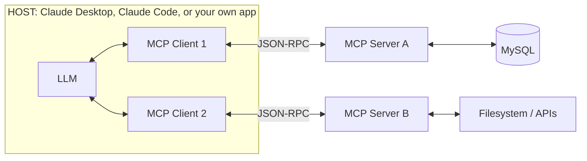

- **Host**: the AI application the user interacts with (Claude Desktop, Claude Code, an IDE, your own agent). It manages the LLM and one or more clients.
- **MCP Client**: lives inside the host. Each client keeps a **1:1 connection** with a single server.
- **MCP Server**: a lightweight program that exposes capabilities (tools/resources/prompts) and talks to the real system (database, API, files).

The LLM never talks to MySQL directly. It asks the host to call a tool, the client forwards the call to the server, the server runs a **parameterized SQL query**, and the result flows back.

---

## 3. The Three Server Primitives

| Primitive | Controlled by | Purpose | Example in this tutorial |
|---|---|---|---|
| **Tool** | Model | Actions with side effects or computation | `create_employee`, `update_employee`, `delete_employee`, `count_employees` |
| **Resource** | Application | Read-only context data | `mysql://schema/employees` (table structure) |
| **Prompt** | User | Reusable templates / workflows | `analyze_department` |

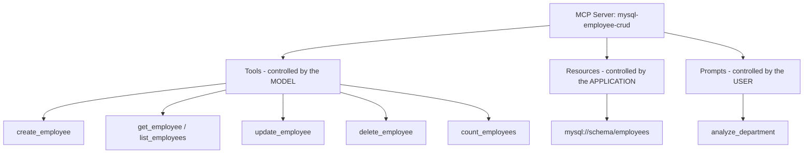

Clients can also offer capabilities back to servers (such as *sampling*, *roots*, *elicitation*), but those are advanced topics.

---

## 4. Transports and Protocol Lifecycle

### Transports

| Transport | Use case |
|---|---|
| **stdio** | Server runs as a **local subprocess** of the client. Messages go over stdin/stdout. Simplest; used by Claude Desktop and Claude Code for local servers. |
| **Streamable HTTP** | Server runs as a **remote/web service** that many clients can reach. Used for hosted servers. |

> **Golden rule for stdio servers:** never `print()` to stdout. stdout carries the protocol messages. Log to **stderr** instead.

### Lifecycle

1. **Initialize**: the client sends `initialize` with its protocol version and capabilities; the server replies with its own; the client sends `initialized`.
2. **Discovery**: `tools/list`, `resources/list`, `prompts/list`.
3. **Operation**: `tools/call`, `resources/read`, `prompts/get`.
4. **Shutdown**: the connection closes.

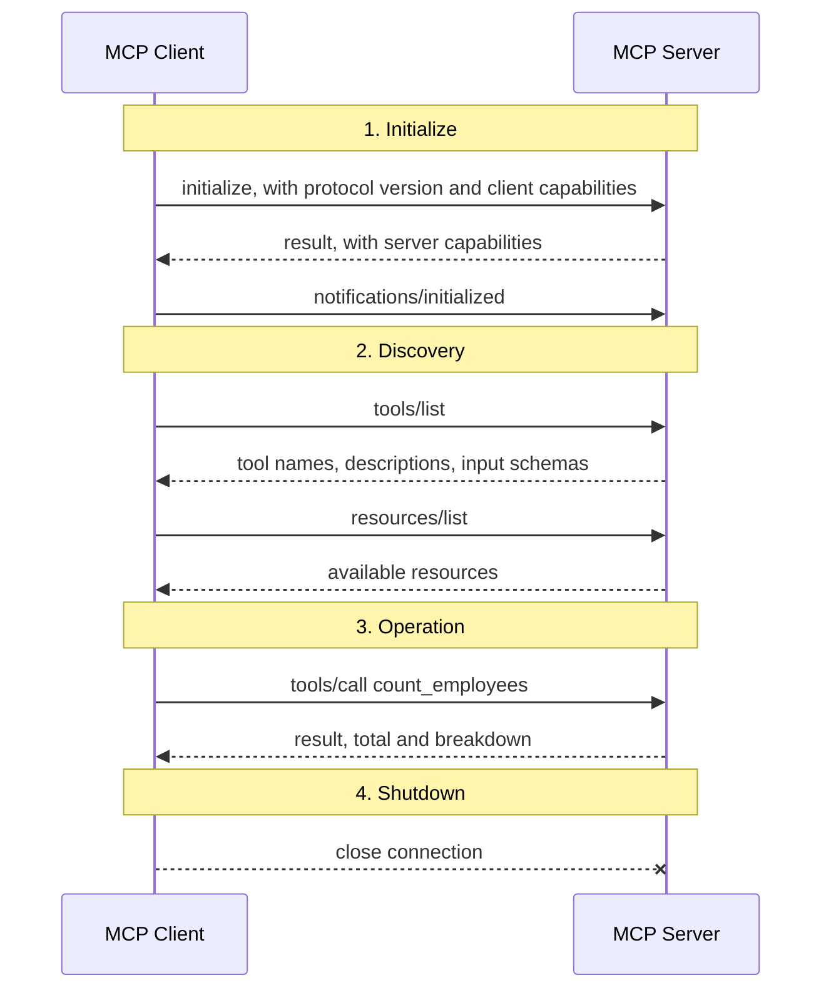

A tool call on the wire looks like this:

```json
{
  "jsonrpc": "2.0",
  "id": 7,
  "method": "tools/call",
  "params": {
    "name": "count_employees",
    "arguments": { "department": "Engineering" }
  }
}
```

---

## 5. Project Overview

We build a **Employee Directory** MCP server backed by MySQL.

```
mcp-mysql-crud/
├── .env                 # DB credentials (never commit)
├── requirements.txt
├── schema.sql           # DB + table + sample data
├── server.py            # MCP server (MySQL CRUD tools)
├── client_demo.py       # Plain MCP client: runs the full CRUD cycle
└── client_llm.py        # Claude-powered client: natural language -> tool calls
```

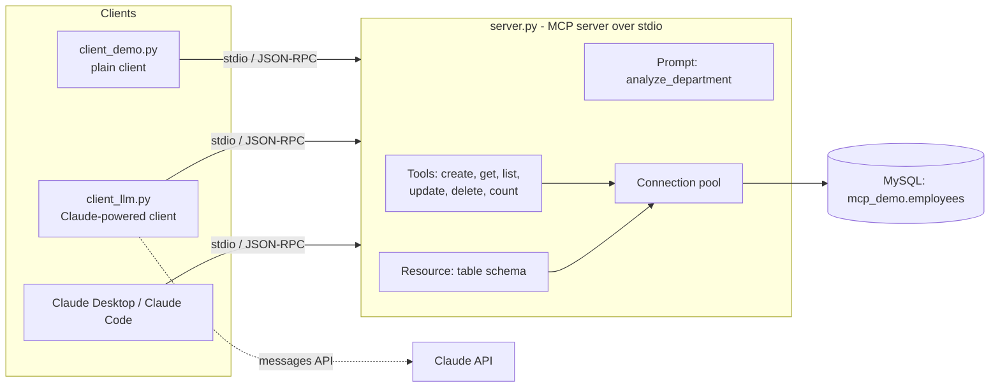

How each tool maps to SQL:

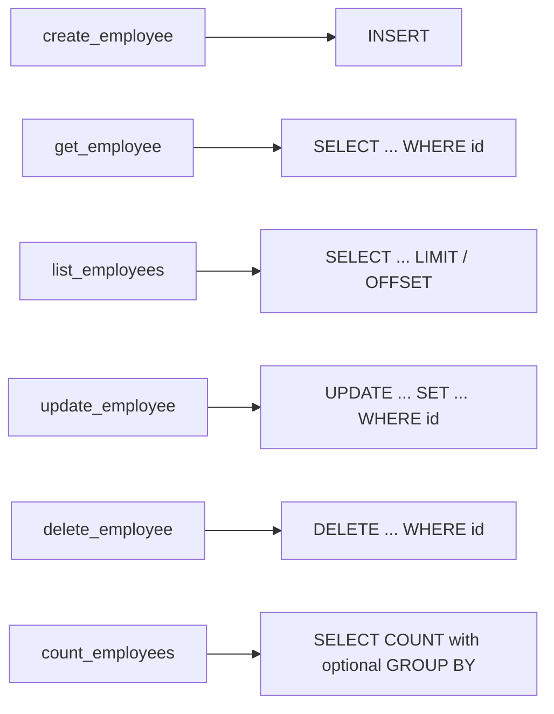

**Tools we will expose:**

| Tool | SQL | Description |
|---|---|---|
| `create_employee` | `INSERT` | Add a new employee |
| `get_employee` | `SELECT ... WHERE id` | Fetch one employee |
| `list_employees` | `SELECT ... LIMIT/OFFSET` | List with optional department filter and pagination |
| `update_employee` | `UPDATE` | Update selected fields |
| `delete_employee` | `DELETE` | Remove an employee |
| `count_employees` | `SELECT COUNT(*)` | Count rows, optionally per department |

**Stack:** Python 3.10+, the official `mcp` Python SDK (FastMCP API), `mysql-connector-python`, MySQL 8.

> The same concepts apply with the TypeScript, Java (Spring AI), Kotlin, or C# SDKs.

---

## 6. Step 1: Prepare MySQL

### Option A: Docker (quickest)

```bash
docker run -d --name mcp-mysql \
  -e MYSQL_ROOT_PASSWORD=rootpass \
  -p 3306:3306 \
  mysql:8
```

Wait ~20 seconds for startup, then open a shell:

```bash
docker exec -it mcp-mysql mysql -uroot -prootpass
```

### Option B: Existing local MySQL

Just connect with your usual client.

### Create the schema: `schema.sql`

```sql
CREATE DATABASE IF NOT EXISTS mcp_demo
  CHARACTER SET utf8mb4 COLLATE utf8mb4_unicode_ci;

USE mcp_demo;

CREATE TABLE IF NOT EXISTS employees (
  id          INT UNSIGNED AUTO_INCREMENT PRIMARY KEY,
  name        VARCHAR(100)  NOT NULL,
  email       VARCHAR(150)  NOT NULL UNIQUE,
  department  VARCHAR(80)   NOT NULL,
  salary      DECIMAL(10,2) NOT NULL DEFAULT 0.00,
  created_at  TIMESTAMP     NOT NULL DEFAULT CURRENT_TIMESTAMP,
  updated_at  TIMESTAMP     NOT NULL DEFAULT CURRENT_TIMESTAMP
                            ON UPDATE CURRENT_TIMESTAMP,
  INDEX idx_department (department)
) ENGINE=InnoDB;

INSERT INTO employees (name, email, department, salary) VALUES
  ('Asha Raman',  'asha@example.com',  'Engineering', 120000.00),
  ('Karthik M',   'karthik@example.com','Engineering', 110000.00),
  ('Divya S',     'divya@example.com', 'Design',       90000.00),
  ('Rahul K',     'rahul@example.com', 'Sales',        80000.00);
```

Table structure:

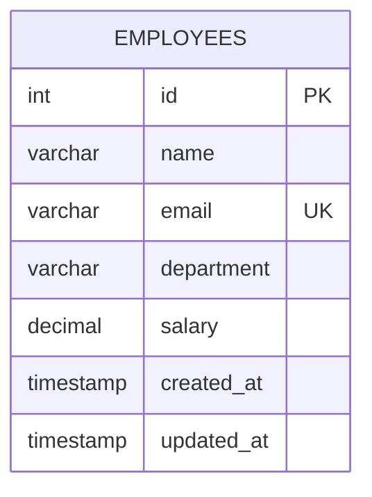

Load it:

```bash
# Docker
docker exec -i mcp-mysql mysql -uroot -prootpass < schema.sql
# or local
mysql -u root -p < schema.sql
```

### Create a least-privilege user (recommended)

Do **not** let your MCP server connect as `root`.

```sql
CREATE USER 'mcp_user'@'%' IDENTIFIED BY 'StrongPassword!123';
GRANT SELECT, INSERT, UPDATE, DELETE ON mcp_demo.employees TO 'mcp_user'@'%';
FLUSH PRIVILEGES;
```

Notice there is no `DROP`, `ALTER`, or `GRANT` permission. Even if the model misbehaves, the database itself blocks destructive schema changes.

---

## 7. Step 2: Project Setup

```bash
mkdir mcp-mysql-crud && cd mcp-mysql-crud
python -m venv .venv
source .venv/bin/activate        # Windows: .venv\Scripts\activate
```

`requirements.txt`:

```text
mcp[cli]
mysql-connector-python
python-dotenv
anthropic
```

```bash
pip install -r requirements.txt
```

`.env`:

```env
MYSQL_HOST=127.0.0.1
MYSQL_PORT=3306
MYSQL_USER=mcp_user
MYSQL_PASSWORD=StrongPassword!123
MYSQL_DATABASE=mcp_demo

# Only needed for client_llm.py
ANTHROPIC_API_KEY=your_key_here
```

Add `.env` to `.gitignore`.

---

## 8. Step 3: Build the MCP Server

Create `server.py`.

```python
"""
MySQL CRUD MCP server (stdio transport) built with FastMCP.

IMPORTANT: never print() to stdout in a stdio server.
Log to stderr only.
"""
import logging
import os
import sys
from contextlib import contextmanager
from datetime import date, datetime
from decimal import Decimal
from pathlib import Path

import mysql.connector
from dotenv import load_dotenv
from mcp.server.fastmcp import FastMCP
from mysql.connector import Error, pooling

# Load .env that sits next to this file (works no matter where the client launches us from)
load_dotenv(Path(__file__).parent / ".env")

logging.basicConfig(
    level=logging.INFO,
    stream=sys.stderr,  # stderr, NOT stdout
    format="%(asctime)s [%(levelname)s] %(message)s",
)
log = logging.getLogger("mysql-mcp")

# ---------------------------------------------------------------------------
# 1. Database connection pool
# ---------------------------------------------------------------------------
pool = pooling.MySQLConnectionPool(
    pool_name="mcp_pool",
    pool_size=5,
    host=os.getenv("MYSQL_HOST", "127.0.0.1"),
    port=int(os.getenv("MYSQL_PORT", "3306")),
    user=os.environ["MYSQL_USER"],
    password=os.environ["MYSQL_PASSWORD"],
    database=os.environ["MYSQL_DATABASE"],
)


@contextmanager
def db_cursor(commit: bool = False):
    """Borrow a pooled connection, yield a dict cursor, handle commit/rollback."""
    conn = pool.get_connection()
    cur = conn.cursor(dictionary=True)
    try:
        yield cur
        if commit:
            conn.commit()
    except Error:
        conn.rollback()
        raise
    finally:
        cur.close()
        conn.close()  # returns the connection to the pool


def clean(row: dict | None) -> dict | None:
    """Make a DB row JSON-serializable (Decimal -> float, datetime -> ISO string)."""
    if row is None:
        return None
    out = {}
    for k, v in row.items():
        if isinstance(v, Decimal):
            out[k] = float(v)
        elif isinstance(v, (datetime, date)):
            out[k] = v.isoformat()
        else:
            out[k] = v
    return out


# ---------------------------------------------------------------------------
# 2. Create the MCP server
# ---------------------------------------------------------------------------
mcp = FastMCP("mysql-employee-crud")


# ---------------------------------------------------------------------------
# 3. TOOLS
# The type hints become the JSON input schema; the docstring becomes the
# tool description the LLM reads to decide when to call the tool.
# ---------------------------------------------------------------------------
@mcp.tool()
def create_employee(name: str, email: str, department: str, salary: float = 0.0) -> dict:
    """Create a new employee record and return it. Email must be unique."""
    if salary < 0:
        raise ValueError("salary must be >= 0")
    try:
        with db_cursor(commit=True) as cur:
            cur.execute(
                "INSERT INTO employees (name, email, department, salary) "
                "VALUES (%s, %s, %s, %s)",
                (name, email, department, salary),
            )
            new_id = cur.lastrowid
            cur.execute("SELECT * FROM employees WHERE id = %s", (new_id,))
            return clean(cur.fetchone())
    except Error as e:
        if e.errno == 1062:  # duplicate entry
            raise ValueError(f"An employee with email '{email}' already exists") from e
        log.exception("create_employee failed")
        raise


@mcp.tool()
def get_employee(employee_id: int) -> dict:
    """Fetch a single employee by numeric ID."""
    with db_cursor() as cur:
        cur.execute("SELECT * FROM employees WHERE id = %s", (employee_id,))
        row = cur.fetchone()
    if row is None:
        raise ValueError(f"No employee with id {employee_id}")
    return clean(row)


@mcp.tool()
def list_employees(department: str | None = None, limit: int = 20, offset: int = 0) -> dict:
    """List employees. Optionally filter by department. Supports pagination."""
    limit = max(1, min(limit, 100))  # hard cap protects the DB and the context window
    offset = max(0, offset)
    sql = "SELECT * FROM employees"
    params: list = []
    if department:
        sql += " WHERE department = %s"
        params.append(department)
    sql += " ORDER BY id LIMIT %s OFFSET %s"
    params += [limit, offset]
    with db_cursor() as cur:
        cur.execute(sql, params)
        rows = [clean(r) for r in cur.fetchall()]
    return {"count": len(rows), "limit": limit, "offset": offset, "employees": rows}


@mcp.tool()
def update_employee(
    employee_id: int,
    name: str | None = None,
    email: str | None = None,
    department: str | None = None,
    salary: float | None = None,
) -> dict:
    """Update one or more fields of an employee. Only provided fields are changed."""
    candidates = {"name": name, "email": email, "department": department, "salary": salary}
    fields = {col: val for col, val in candidates.items() if val is not None}
    if not fields:
        raise ValueError("Provide at least one field to update")
    if "salary" in fields and fields["salary"] < 0:
        raise ValueError("salary must be >= 0")

    # Column names come from the fixed dict above (never from user input),
    # values are bound as parameters. This is injection-safe.
    set_clause = ", ".join(f"{col} = %s" for col in fields)
    params = list(fields.values()) + [employee_id]
    try:
        with db_cursor(commit=True) as cur:
            cur.execute(f"UPDATE employees SET {set_clause} WHERE id = %s", params)
            cur.execute("SELECT * FROM employees WHERE id = %s", (employee_id,))
            row = cur.fetchone()
    except Error as e:
        if e.errno == 1062:
            raise ValueError("That email is already used by another employee") from e
        log.exception("update_employee failed")
        raise
    if row is None:
        raise ValueError(f"No employee with id {employee_id}")
    return clean(row)


@mcp.tool()
def delete_employee(employee_id: int) -> dict:
    """Permanently delete an employee by ID."""
    with db_cursor(commit=True) as cur:
        cur.execute("DELETE FROM employees WHERE id = %s", (employee_id,))
        deleted = cur.rowcount
    if deleted == 0:
        raise ValueError(f"No employee with id {employee_id}")
    return {"deleted": True, "id": employee_id}


@mcp.tool()
def count_employees(department: str | None = None) -> dict:
    """Count employees. If department is given, count only that department;
    otherwise return the total plus a per-department breakdown."""
    with db_cursor() as cur:
        if department:
            cur.execute(
                "SELECT COUNT(*) AS total FROM employees WHERE department = %s",
                (department,),
            )
            return {"department": department, "total": cur.fetchone()["total"]}
        cur.execute("SELECT COUNT(*) AS total FROM employees")
        total = cur.fetchone()["total"]
        cur.execute(
            "SELECT department, COUNT(*) AS total FROM employees "
            "GROUP BY department ORDER BY department"
        )
        breakdown = {r["department"]: r["total"] for r in cur.fetchall()}
    return {"total": total, "by_department": breakdown}


# ---------------------------------------------------------------------------
# 4. RESOURCE: read-only context the host can attach to a conversation
# ---------------------------------------------------------------------------
@mcp.resource("mysql://schema/employees")
def employees_schema() -> str:
    """Structure of the employees table."""
    with db_cursor() as cur:
        cur.execute("DESCRIBE employees")
        rows = cur.fetchall()
    return "\n".join(
        f"{r['Field']:<12} {r['Type']:<16} null={r['Null']:<3} key={r['Key']}" for r in rows
    )


# ---------------------------------------------------------------------------
# 5. PROMPT: reusable template the user can trigger
# ---------------------------------------------------------------------------
@mcp.prompt()
def analyze_department(department: str) -> str:
    """Ask the model to analyze a department using the available tools."""
    return (
        f"Using the employee tools, list everyone in the '{department}' department, "
        f"count them, and summarize the salary range. Present the result as a short report."
    )


# ---------------------------------------------------------------------------
# 6. Run
# ---------------------------------------------------------------------------
if __name__ == "__main__":
    log.info("Starting mysql-employee-crud MCP server (stdio)")
    mcp.run(transport="stdio")
    # For a remote server instead:  mcp.run(transport="streamable-http")
```

### How it works

1. `FastMCP("name")` creates the server.
2. `@mcp.tool()` registers a function. The SDK reads the **type hints** to generate a JSON Schema and the **docstring** as the description. Good docstrings directly improve how well the LLM uses your tools.
3. Raised exceptions (e.g., `ValueError`) are returned to the client as **tool errors** (`isError: true`), so the model can read the message and recover.
4. `mcp.run(transport="stdio")` starts the JSON-RPC loop on stdin/stdout.

---

## 9. Step 4: Test with MCP Inspector

Before writing a client, use the official visual debugger:

```bash
mcp dev server.py
```

This opens the **MCP Inspector** in your browser (a local URL is printed). You can:

- See the list of tools, resources, and prompts
- Fill in arguments and call each tool
- Inspect the raw JSON-RPC messages

Try `count_employees` with no arguments. You should see `{"total": 4, "by_department": {...}}`.

---

## 10. Step 5: Build a Plain MCP Client

This client has **no LLM**. It launches the server, discovers tools, and runs a full CRUD cycle. It shows exactly what an MCP client does.

Create `client_demo.py`:

```python
import asyncio
import json
import sys

from mcp import ClientSession, StdioServerParameters
from mcp.client.stdio import stdio_client

# How to launch the server: the client starts it as a subprocess
server_params = StdioServerParameters(
    command=sys.executable,   # the same Python interpreter running this script
    args=["server.py"],
)


def parse(result):
    """Tool results arrive as a list of content blocks; ours are JSON text."""
    if result.isError:
        return {"ERROR": result.content[0].text}
    return json.loads(result.content[0].text)


async def call(session, name, **arguments):
    result = await session.call_tool(name, arguments=arguments)
    data = parse(result)
    print(f"\n>>> {name}({arguments})\n{json.dumps(data, indent=2)}")
    return data


async def main():
    async with stdio_client(server_params) as (read, write):
        async with ClientSession(read, write) as session:
            # 1. Handshake
            await session.initialize()

            # 2. Discovery
            tools = await session.list_tools()
            print("TOOLS:", [t.name for t in tools.tools])

            resources = await session.list_resources()
            print("RESOURCES:", [str(r.uri) for r in resources.resources])

            schema = await session.read_resource("mysql://schema/employees")
            print("\nSCHEMA:\n" + schema.contents[0].text)

            # 3. Full CRUD cycle
            await call(session, "count_employees")                                  # COUNT

            created = await call(session, "create_employee",                         # CREATE
                                 name="Meena R", email="meena@example.com",
                                 department="Engineering", salary=105000)
            emp_id = created["id"]

            await call(session, "get_employee", employee_id=emp_id)                  # READ (one)
            await call(session, "list_employees", department="Engineering")          # READ (many)

            await call(session, "update_employee", employee_id=emp_id,               # UPDATE
                       salary=115000, department="Platform")

            await call(session, "count_employees", department="Platform")            # COUNT filtered

            await call(session, "delete_employee", employee_id=emp_id)               # DELETE
            await call(session, "get_employee", employee_id=emp_id)                  # shows error path
            await call(session, "count_employees")                                   # back to original


if __name__ == "__main__":
    asyncio.run(main())
```

Run it:

```bash
python client_demo.py
```

### What each part does

| Code | Purpose |
|---|---|
| `StdioServerParameters` | Tells the client how to spawn the server process |
| `stdio_client(...)` | Opens the stdin/stdout transport and gives you `(read, write)` streams |
| `ClientSession` | The protocol session (handles JSON-RPC ids, requests, responses) |
| `session.initialize()` | Handshake: version + capability negotiation |
| `session.list_tools()` | Dynamic tool discovery |
| `session.call_tool(name, arguments)` | Executes a tool on the server |
| `session.read_resource(uri)` | Reads a resource |

---

## 11. Step 6: Build a Claude-Powered MCP Client

Now the real use case: the user types natural language and **Claude decides which MySQL tools to call**.

The flow:

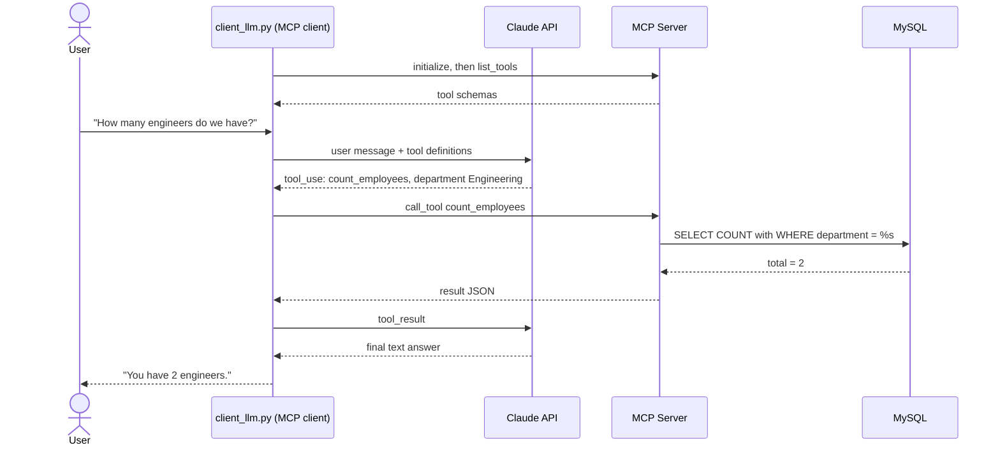

Create `client_llm.py`:

```python
import asyncio
import os
import sys
from pathlib import Path

from anthropic import AsyncAnthropic
from dotenv import load_dotenv
from mcp import ClientSession, StdioServerParameters
from mcp.client.stdio import stdio_client

load_dotenv(Path(__file__).parent / ".env")

MODEL = "claude-sonnet-5-5"   # change to any Claude model you have access to
anthropic = AsyncAnthropic()  # reads ANTHROPIC_API_KEY from the environment

server_params = StdioServerParameters(command=sys.executable, args=["server.py"])

SYSTEM = (
    "You manage an employee directory through the provided tools. "
    "Use tools for every data question; never guess data. "
    "Ask for confirmation before deleting anything."
)


def to_anthropic_tools(mcp_tools):
    """Convert MCP tool definitions to the Anthropic Messages API tool format."""
    return [
        {"name": t.name, "description": t.description or "", "input_schema": t.inputSchema}
        for t in mcp_tools
    ]


async def ask(session: ClientSession, tools: list, history: list, user_text: str) -> str:
    history.append({"role": "user", "content": user_text})

    while True:
        response = await anthropic.messages.create(
            model=MODEL,
            max_tokens=1024,
            system=SYSTEM,
            tools=tools,
            messages=history,
        )
        history.append({"role": "assistant", "content": response.content})

        # No more tool calls: return the final text answer
        if response.stop_reason != "tool_use":
            return "".join(b.text for b in response.content if b.type == "text")

        # Execute every requested tool through MCP and send the results back
        tool_results = []
        for block in response.content:
            if block.type == "tool_use":
                print(f"   [tool] {block.name}({block.input})")
                result = await session.call_tool(block.name, block.input)
                text = "".join(c.text for c in result.content if c.type == "text")
                tool_results.append({
                    "type": "tool_result",
                    "tool_use_id": block.id,
                    "content": text,
                    "is_error": bool(result.isError),
                })
        history.append({"role": "user", "content": tool_results})


async def main():
    async with stdio_client(server_params) as (read, write):
        async with ClientSession(read, write) as session:
            await session.initialize()
            tools = to_anthropic_tools((await session.list_tools()).tools)
            print(f"Connected. Tools: {[t['name'] for t in tools]}")
            print("Type a request (or 'quit').\n")

            history: list = []
            while True:
                user_text = input("you> ").strip()
                if user_text.lower() in {"quit", "exit"}:
                    break
                if user_text:
                    print("claude>", await ask(session, tools, history, user_text), "\n")


if __name__ == "__main__":
    asyncio.run(main())
```

The loop inside `ask()` looks like this:

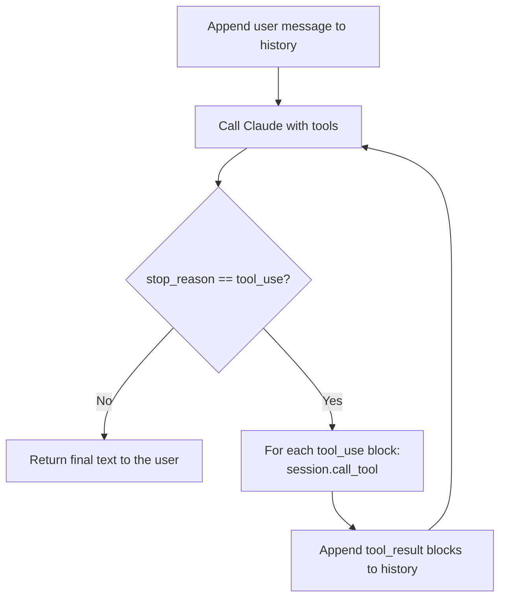

Run it and try prompts like:

```text
you> How many employees do we have in each department?
you> Add Priya N, priya@example.com, Design, salary 95000
you> Give everyone in Sales... actually just update Rahul's salary to 85000
you> Show me all Engineering employees
you> Delete the employee with email priya@example.com
```

Claude will chain tools as needed (for example `list_employees` to find an id, then `delete_employee`).

---

## 12. Step 7: Plug the Server into Claude Desktop / Claude Code

Your server is not tied to your own client. Any MCP host can use it.

### Claude Desktop

Edit `claude_desktop_config.json` (Settings > Developer > Edit Config):

```json
{
  "mcpServers": {
    "mysql-crud": {
      "command": "/absolute/path/to/mcp-mysql-crud/.venv/bin/python",
      "args": ["/absolute/path/to/mcp-mysql-crud/server.py"]
    }
  }
}
```

Windows example paths: `C:\\path\\to\\.venv\\Scripts\\python.exe`. Use **absolute paths**, then restart Claude Desktop. Because `server.py` loads the `.env` beside itself, no extra environment config is needed.

### Claude Code

```bash
claude mcp add mysql-crud -- /absolute/path/to/.venv/bin/python /absolute/path/to/server.py
claude mcp list
```

Then ask Claude Code: *"How many employees are in the Engineering department?"*

---

## 13. Decorators (Annotations) Deep Dive

> **Terminology.** In Python the `@something` syntax is called a **decorator**. People often call it an "annotation" (Java and Spring developers especially, because Java uses `@Tool`-style annotations). Python also has *type annotations* (`name: str`) and MCP has its own *tool annotations* (metadata hints such as `readOnlyHint`). All three appear in this tutorial, so this section covers each one separately.

### 13.1 Python primer: what is a decorator?

A decorator is a function that receives another function and returns a function (often the same one, after doing some bookkeeping).

```python
@my_decorator
def hello(): ...

# is exactly the same as:
def hello(): ...
hello = my_decorator(hello)
```

MCP's decorators use the **registration pattern**: when Python imports `server.py` and reaches `@mcp.tool()`, the decorator stores your function in a registry inside the `FastMCP` object. It does **not** run your function. Later, when a client sends `tools/list` or `tools/call`, the server looks things up in that registry.

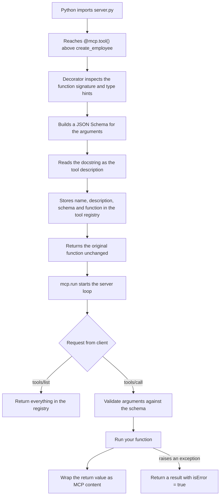

### 13.2 `@contextmanager` (Python standard library, not MCP)

Used in our server here:

```python
@contextmanager
def db_cursor(commit: bool = False):
    conn = pool.get_connection()
    cur = conn.cursor(dictionary=True)
    try:
        yield cur
        if commit:
            conn.commit()
    except Error:
        conn.rollback()
        raise
    finally:
        cur.close()
        conn.close()
```

**Purpose:** turn a generator function into something you can use with a `with` statement, so setup and cleanup are guaranteed even if an exception occurs. Without it you would write `try/finally` blocks in every tool.

**How it works:**

- Code **before** `yield` is the *setup* (borrow a connection, create a cursor).
- The value after `yield` is what `as cur` receives.
- The body of your `with` block runs while the generator is paused at `yield`.
- Code **after** `yield` is the *teardown*. If the body raised an exception, Python throws that exception **into the generator at the `yield` line**, so your `except` and `finally` blocks run.

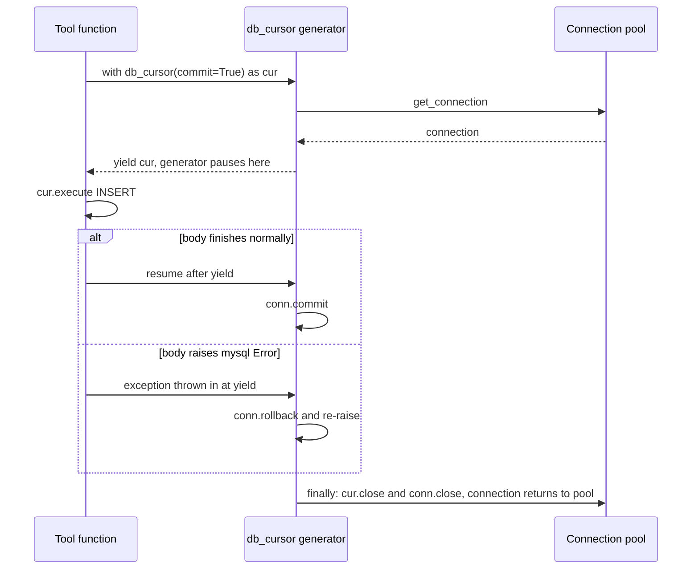

| Related decorator | Where it comes from | Use |
|---|---|---|
| `@contextmanager` | `contextlib` | Synchronous setup/teardown with `with` |
| `@asynccontextmanager` | `contextlib` | Async setup/teardown with `async with`. Used for the **FastMCP lifespan** (see 13.7) |

> **Improvement idea:** our `except Error` only rolls back on MySQL errors. Using `except Exception:` would roll back on any exception raised inside the block.

### 13.3 `@mcp.tool()`

Registers a function as an MCP **tool**: an action the model may call.

```python
@mcp.tool()
def create_employee(name: str, email: str, department: str, salary: float = 0.0) -> dict:
    """Create a new employee record and return it. Email must be unique."""
```

FastMCP converts that into the following definition (shown approximately; this is what `tools/list` returns):

```json
{
  "name": "create_employee",
  "description": "Create a new employee record and return it. Email must be unique.",
  "inputSchema": {
    "type": "object",
    "properties": {
      "name":       { "title": "Name",       "type": "string" },
      "email":      { "title": "Email",      "type": "string" },
      "department": { "title": "Department", "type": "string" },
      "salary":     { "title": "Salary",     "type": "number", "default": 0.0 }
    },
    "required": ["name", "email", "department"],
    "title": "create_employeeArguments"
  }
}
```

**What maps to what:**

| In your Python code | Becomes in the MCP tool |
|---|---|
| Function name | Tool `name` (override with `name=`) |
| Docstring | Tool `description`, which is what the LLM reads to decide when to call it |
| Parameter names and type hints | `inputSchema` properties and types |
| Parameters without defaults | `required` list |
| Default values | `default` in the schema |
| `str \| None = None` | Optional parameter |
| Return value | Result content. Newer SDK versions also emit `structuredContent` when the return type is typed, such as a `dict`, a dataclass or a Pydantic model |
| Raised exception | Result with `isError: true` and the message as text |

**Arguments the decorator itself accepts** (names can vary slightly by SDK version, so check `help(mcp.tool)` for yours):

| Argument | Meaning |
|---|---|
| `name` | Override the tool name |
| `title` | Human-friendly display name |
| `description` | Override the docstring |
| `annotations` | MCP tool annotations (hints), explained next |
| `structured_output` | Force or disable structured output |

> **Always write `@mcp.tool()` with parentheses.** `@mcp.tool` without them raises an error telling you to call it.

#### Tool annotations (MCP metadata hints)

These are **not** Python decorators. They are optional metadata attached to a tool so hosts can make better UX and safety decisions (for example, auto-approving read-only tools but asking before destructive ones).

```python
from mcp.types import ToolAnnotations

@mcp.tool(
    title="Delete Employee",
    annotations=ToolAnnotations(
        readOnlyHint=False,
        destructiveHint=True,
        idempotentHint=True,
        openWorldHint=False,
    ),
)
def delete_employee(employee_id: int) -> dict: ...
```

| Hint | Spec default | Meaning |
|---|---|---|
| `title` | none | Display name |
| `readOnlyHint` | `false` | The tool does not modify its environment |
| `destructiveHint` | `true` | The tool may delete or overwrite data (only meaningful when not read-only) |
| `idempotentHint` | `false` | Calling it repeatedly with the same arguments has no additional effect (only meaningful when not read-only) |
| `openWorldHint` | `true` | The tool talks to an open, external world (web, third-party APIs). `false` means a closed domain such as our own database |

Suggested values for our six tools:

| Tool | readOnly | destructive | idempotent | openWorld |
|---|---|---|---|---|
| `create_employee` | false | false | false | false |
| `get_employee` | true | n/a | n/a | false |
| `list_employees` | true | n/a | n/a | false |
| `update_employee` | false | true (overwrites values) | true | false |
| `delete_employee` | false | true | true | false |
| `count_employees` | true | n/a | n/a | false |

> **Hints are advisory.** A host may use them, but they are not enforcement. Real protection comes from DB permissions and server-side validation (see section 16).

#### The `Context` parameter (optional)

If a tool declares a parameter typed `Context`, FastMCP injects it automatically, and it does **not** appear in the tool's input schema.

```python
from mcp.server.fastmcp import Context

@mcp.tool()
async def export_all(ctx: Context) -> str:
    await ctx.info("Export started")          # sends a log message to the client
    await ctx.report_progress(1, 3)           # progress notification
    pool = ctx.request_context.lifespan_context.pool   # objects created in the lifespan
    return "done"
```

### 13.4 `@mcp.resource(uri)`

Registers **read-only data** addressed by a URI. Resources are meant to be *context* the host or user can attach, rather than actions the model performs.

```python
# Static resource: fixed URI
@mcp.resource("mysql://schema/employees")
def employees_schema() -> str: ...

# Resource template: {employee_id} is extracted from the URI and passed to the function
@mcp.resource("mysql://employees/{employee_id}")
def employee_profile(employee_id: int) -> str:
    """One employee as JSON text."""
    with db_cursor() as cur:
        cur.execute("SELECT * FROM employees WHERE id = %s", (employee_id,))
        return json.dumps(clean(cur.fetchone()))
```

| Aspect | Details |
|---|---|
| Required argument | The URI (any scheme you like: `mysql://`, `file://`, `config://`) |
| Optional arguments | `name`, `title`, `description`, `mime_type` (for example `application/json`) |
| Static vs template | A URI with no `{}` is static and appears in `resources/list`. A URI with `{param}` is a template and appears in `resources/templates/list` |
| Parameter rule | Function parameter names must match the `{placeholders}` in the URI |
| Return value | Text (`str`) or bytes for binary content |
| Client call | `session.read_resource("mysql://employees/3")` |

**Tool or resource?** If the model should *decide to do something* (search, write, compute), use a tool. If the application should be able to *attach known data* (a schema, a config file, a document), use a resource.

### 13.5 `@mcp.prompt()`

Registers a **reusable prompt template** the user can pick (in Claude Desktop these appear as selectable prompts or slash commands).

```python
from mcp.server.fastmcp.prompts import base

# Simple: returning a string becomes a single user message
@mcp.prompt()
def analyze_department(department: str) -> str:
    return f"Using the employee tools, summarize the '{department}' department."

# Multi-message: return a list of messages
@mcp.prompt(title="Salary Review")
def salary_review(department: str) -> list[base.Message]:
    return [
        base.UserMessage(f"Review salaries in {department}."),
        base.AssistantMessage("Understood. Which tools should I use first?"),
        base.UserMessage("Start with list_employees, then count_employees."),
    ]
```

- Function parameters become the prompt's **arguments** (`prompts/get` takes them).
- The docstring becomes the prompt description.
- Optional decorator arguments: `name`, `title`, `description`.
- Client side: `session.list_prompts()` and `session.get_prompt("analyze_department", {"department": "Sales"})`.

### 13.6 How many decorators (annotations) are there?

It depends on which layer you count. This is the complete picture:

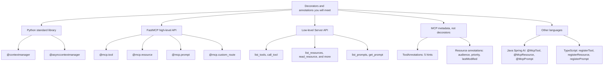

**Layer 1: what this tutorial uses**

| Decorator | Source | Used in our server? |
|---|---|---|
| `@contextmanager` | Python `contextlib` | Yes, `db_cursor` |
| `@mcp.tool()` | FastMCP | Yes, 6 times |
| `@mcp.resource(uri)` | FastMCP | Yes, 1 time |
| `@mcp.prompt()` | FastMCP | Yes, 1 time |

**Layer 2: the complete FastMCP set**

FastMCP has **three core decorators**: `tool`, `resource`, `prompt`. Over HTTP transports there is also a fourth, `@mcp.custom_route(path, methods=[...])`, for plain web endpoints such as `/health` that are not part of the MCP protocol.

**Layer 3: low-level `Server` API (about a dozen)**

If you use `from mcp.server import Server` instead of FastMCP, you register one handler per protocol method. In the 1.x Python SDK these are decorators:

| Decorator | Handles |
|---|---|
| `@server.list_tools()` | `tools/list` |
| `@server.call_tool()` | `tools/call` |
| `@server.list_resources()` | `resources/list` |
| `@server.read_resource()` | `resources/read` |
| `@server.list_resource_templates()` | `resources/templates/list` |
| `@server.subscribe_resource()` / `@server.unsubscribe_resource()` | resource subscriptions |
| `@server.list_prompts()` | `prompts/list` |
| `@server.get_prompt()` | `prompts/get` |
| `@server.completion()` | argument auto-completion |
| `@server.set_logging_level()` | `logging/setLevel` |
| `@server.progress_notification()` | progress notifications |

FastMCP is built on top of this layer. Prefer FastMCP unless you need full control.

**Layer 4: MCP annotations (metadata, not decorators)**

- **Tool annotations:** 5 fields (`title`, `readOnlyHint`, `destructiveHint`, `idempotentHint`, `openWorldHint`).
- **Resource and content annotations:** `audience` (who should see it: user and/or assistant), `priority` (0 to 1), `lastModified`.

**Layer 5: other SDKs** (useful because your background includes Java/Spring Boot)

| Language | Style |
|---|---|
| Python | Decorators: `@mcp.tool()`, `@mcp.resource()`, `@mcp.prompt()` |
| Java (Spring AI MCP) | Annotations such as `@McpTool`, `@McpToolParam`, `@McpResource`, `@McpPrompt` |
| TypeScript | No decorators; methods like `server.registerTool(...)` |

> **Version note:** SDKs evolve quickly. The counts above reflect the 1.x Python SDK. Check `help(FastMCP)` and the changelog of the version you install.

### 13.7 Putting `@asynccontextmanager` to work: the lifespan

Right now our pool is created at import time. FastMCP offers a cleaner way: a **lifespan**, a function decorated with `@asynccontextmanager` that runs setup when the server starts and teardown when it stops.

```python
from collections.abc import AsyncIterator
from contextlib import asynccontextmanager
from dataclasses import dataclass

@dataclass
class AppContext:
    pool: pooling.MySQLConnectionPool

@asynccontextmanager
async def app_lifespan(server: FastMCP) -> AsyncIterator[AppContext]:
    pool = pooling.MySQLConnectionPool(pool_name="mcp_pool", pool_size=5, ...)  # startup
    try:
        yield AppContext(pool=pool)       # server runs while paused here
    finally:
        log.info("Server stopping, release resources here")   # shutdown

mcp = FastMCP("mysql-employee-crud", lifespan=app_lifespan)

@mcp.tool()
def count_employees(ctx: Context, department: str | None = None) -> dict:
    pool = ctx.request_context.lifespan_context.pool
    ...
```

---

## 14. Sessions Deep Dive

### 14.1 What is a session?

A **session** is the stateful connection between **one MCP client and one MCP server**, starting at the `initialize` handshake and ending when the connection closes. Everything (capability negotiation, request IDs, notifications, subscriptions) is scoped to a session.

There are two objects, one on each side:

| Side | Object | Created by |
|---|---|---|
| Client | `ClientSession` | You, in `client_demo.py`: `async with ClientSession(read, write)` |
| Server | `ServerSession` | The SDK, automatically, one per connection (you normally never create it). Reachable in a tool via `ctx.session` |

### 14.2 The layers under a session

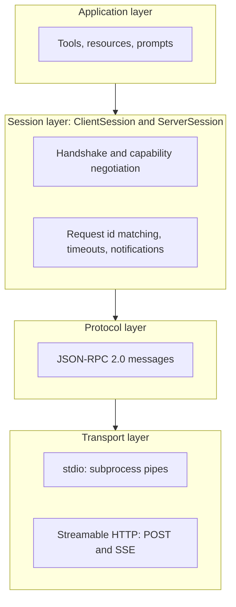

### 14.3 Lifecycle states

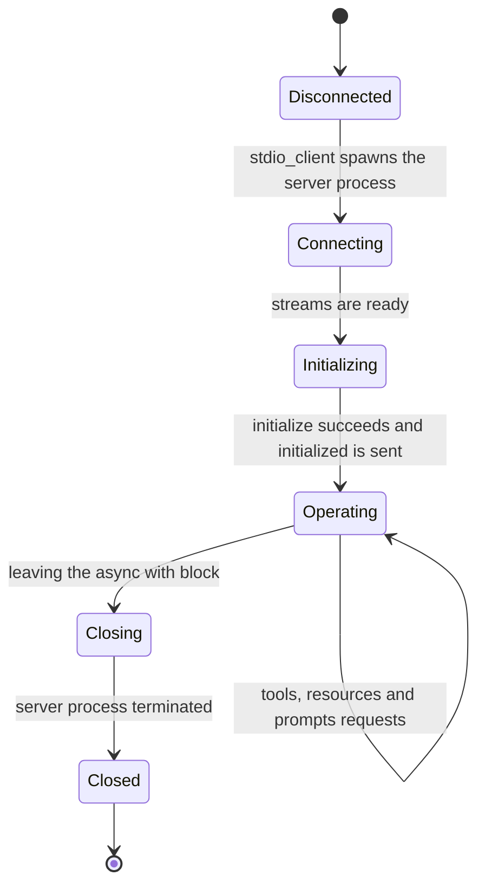

### 14.4 The handshake in detail

Request from the client:

```json
{
  "jsonrpc": "2.0",
  "id": 1,
  "method": "initialize",
  "params": {
    "protocolVersion": "2025-06-18",
    "capabilities": { "roots": { "listChanged": true }, "sampling": {} },
    "clientInfo": { "name": "client_demo", "version": "1.0.0" }
  }
}
```

Response from the server:

```json
{
  "jsonrpc": "2.0",
  "id": 1,
  "result": {
    "protocolVersion": "2025-06-18",
    "capabilities": {
      "tools": { "listChanged": false },
      "resources": { "subscribe": false, "listChanged": false },
      "prompts": { "listChanged": false },
      "logging": {}
    },
    "serverInfo": { "name": "mysql-employee-crud", "version": "1.0.0" }
  }
}
```

Then the client sends the `notifications/initialized` notification and the session is **operating**.

| Field | Meaning |
|---|---|
| `protocolVersion` | Both sides agree on a spec version; if they cannot, the connection fails |
| `capabilities` (server) | What the server offers: `tools`, `resources`, `prompts`, `logging`, `completions` |
| `capabilities` (client) | What the client offers back: `roots`, `sampling`, `elicitation` |
| `listChanged` | Server can notify the client when its list of tools/resources/prompts changes |
| `subscribe` | Client may subscribe to updates of a specific resource |
| `clientInfo` / `serverInfo` | Name and version, for logging and debugging |

A client must only use features the other side declared. If the server did not advertise `tools`, the client should not call `tools/list`.

### 14.5 Request and response correlation

Every **request** has an `id`; the **response** carries the same `id`. A **notification** has no `id` and gets no response. This lets one session handle **many concurrent calls** over a single connection.

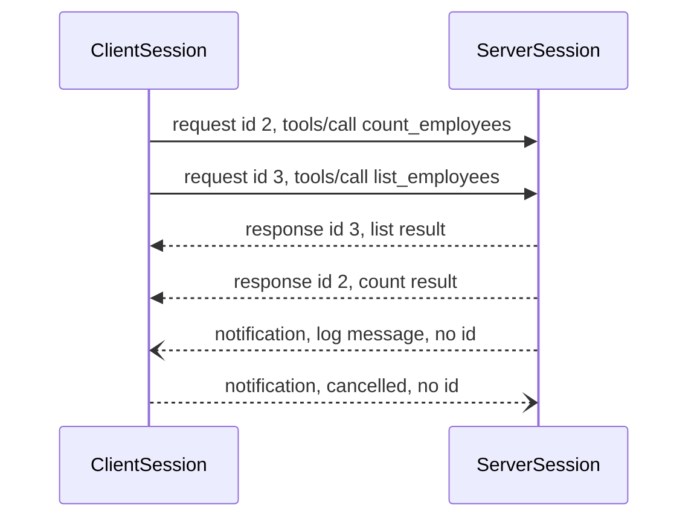

The `ClientSession` keeps a table of pending ids and wakes the right `await` when the matching response arrives. This is why `await session.call_tool(...)` works even when other calls are in flight.

### 14.6 What the `async with` blocks actually do

From `client_demo.py`:

```python
async with stdio_client(server_params) as (read, write):      # (1)
    async with ClientSession(read, write) as session:         # (2)
        await session.initialize()                            # (3)
        result = await session.call_tool("count_employees", arguments={})   # (4)
```

| Step | What happens |
|---|---|
| (1) `stdio_client` | Spawns `python server.py` as a subprocess, connects its stdin/stdout to two async streams: `read` (server to client) and `write` (client to server). On exit it closes the pipes and terminates the process |
| (2) `ClientSession` | Starts a background loop that reads messages from `read`, matches responses to pending requests, and dispatches notifications. On exit it stops that loop |
| (3) `initialize()` | Sends the handshake described in 14.4 |
| (4) `call_tool()` | Sends `tools/call` with a fresh id, waits for the matching response, and returns a `CallToolResult` (`content`, `isError`, and possibly `structuredContent`) |

Because both are context managers, cleanup is guaranteed even if your code crashes. No orphan server processes are left behind.

### 14.7 Session API cheat sheet

**`ClientSession` methods**

| Method | Protocol message |
|---|---|
| `initialize()` | `initialize` |
| `list_tools()` / `call_tool(name, arguments)` | `tools/list`, `tools/call` |
| `list_resources()` / `list_resource_templates()` | `resources/list`, `resources/templates/list` |
| `read_resource(uri)` | `resources/read` |
| `subscribe_resource(uri)` / `unsubscribe_resource(uri)` | `resources/subscribe`, `resources/unsubscribe` |
| `list_prompts()` / `get_prompt(name, arguments)` | `prompts/list`, `prompts/get` |
| `complete(...)` | `completion/complete` |
| `set_logging_level(level)` | `logging/setLevel` |
| `send_ping()` | `ping` |

**Commonly used `ClientSession(...)` constructor options** (check your SDK version):

| Option | Purpose |
|---|---|
| `read_timeout_seconds` | Timeout for requests |
| `sampling_callback` | Lets the *server* ask the client's LLM to generate text |
| `elicitation_callback` | Lets the *server* ask the user a question through the client |
| `list_roots_callback` | Tells the server which directories or URIs it may work in |
| `logging_callback` | Receives server log messages |
| `message_handler` | Receives notifications and other incoming messages |
| `client_info` | Name and version reported in the handshake |

### 14.8 Three different "states" people confuse

In our Claude-powered client there are **three separate things** that sound similar. Keep them apart:

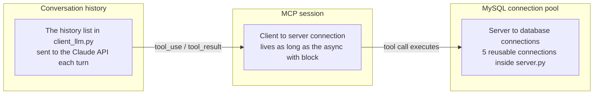

- The **MCP session** does **not** remember the conversation. Chat history lives in the *host/client* (our `history` list).
- The **MySQL pool** is unrelated to MCP sessions. It is just how the server talks to the database efficiently.
- The same session handles many tool calls and many user turns.

### 14.9 Session behavior per transport

| | stdio | Streamable HTTP |
|---|---|---|
| Session lifetime | Equals the server process lifetime (one client per process) | Server may assign a session id; many clients can connect to one server |
| How the session is identified | Implicitly, by the pipes | `Mcp-Session-Id` header returned by the server on `initialize`, then sent by the client on every request |
| Ending | Client closes pipes and terminates process | Client sends `DELETE` with the session id, or the server expires it |
| Stateless option | Not applicable | `FastMCP(..., stateless_http=True)` treats every request independently, which suits horizontally scaled deployments |

### 14.10 Errors inside a session

| Kind | Example | How it appears |
|---|---|---|
| **Tool execution error** | `ValueError("No employee with id 99")` | Normal response with `isError: true`. The LLM can read it and try again |
| **Protocol error** | Unknown tool name, invalid arguments, unsupported method | JSON-RPC `error` object. The SDK raises `McpError` on the client |
| **Transport error** | Server crashed, pipe closed | Exception from the session or stream. Wrap sessions in `try/except` |

---

## 15. MCP Configuration Deep Dive

### 15.1 Important fact: there is no single "MCP config file"

The MCP **specification does not define a configuration file**. Each **host** (Claude Desktop, Claude Code, VS Code, Cursor, and others) defines its own JSON format for "which servers should I launch or connect to". The formats are similar but **not identical**, and the answer to "how many parameters are there?" depends on the host and the transport. There are really **three layers of configuration**:

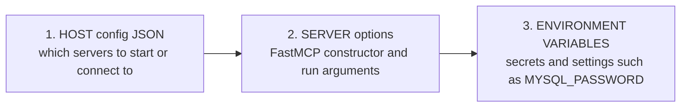

### 15.2 How a host uses the config

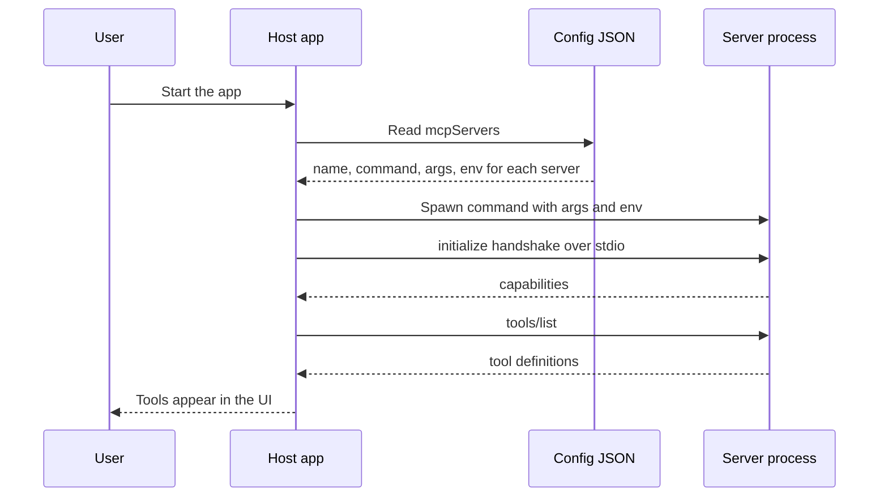

### 15.3 Claude Desktop: `claude_desktop_config.json`

Location:

- macOS: `~/Library/Application Support/Claude/claude_desktop_config.json`
- Windows: `%APPDATA%\Claude\claude_desktop_config.json`

```json
{
  "mcpServers": {
    "mysql-crud": {
      "command": "/abs/path/mcp-mysql-crud/.venv/bin/python",
      "args": ["/abs/path/mcp-mysql-crud/server.py"],
      "env": {
        "MYSQL_HOST": "127.0.0.1",
        "MYSQL_USER": "mcp_user",
        "MYSQL_PASSWORD": "StrongPassword!123",
        "MYSQL_DATABASE": "mcp_demo"
      }
    }
  }
}
```

| Key | Level | Required | Description |
|---|---|---|---|
| `mcpServers` | top level | Yes | Object mapping a **server name** (your choice, shown in the UI) to its settings |
| `command` | per server | Yes | Executable to run (absolute path is safest) |
| `args` | per server | No | Array of command-line arguments |
| `env` | per server | No | Environment variables passed to the server process |

So for local (stdio) servers in Claude Desktop there is **1 top-level key and 3 per-server fields**. The file may also hold other app settings unrelated to MCP. Remote servers are normally added through the app's **Connectors** settings, not by hand-editing this file.

### 15.4 Claude Code: `.mcp.json`

Claude Code reads the same `mcpServers` object from three **scopes**:

| Scope | Stored in | Shared? |
|---|---|---|
| `local` (default) | `~/.claude.json` (tied to the project path) | Only you, only this project |
| `project` | `.mcp.json` in the project root | Yes, commit it to Git for your team |
| `user` | `~/.claude.json` (global) | Only you, all projects |

```json
{
  "mcpServers": {
    "mysql-crud": {
      "type": "stdio",
      "command": "/abs/path/.venv/bin/python",
      "args": ["/abs/path/server.py"],
      "env": {
        "MYSQL_HOST": "${MYSQL_HOST:-127.0.0.1}",
        "MYSQL_USER": "${MYSQL_USER}",
        "MYSQL_PASSWORD": "${MYSQL_PASSWORD}",
        "MYSQL_DATABASE": "mcp_demo"
      }
    },
    "remote-example": {
      "type": "http",
      "url": "${API_BASE_URL:-https://api.example.com}/mcp",
      "headers": { "Authorization": "Bearer ${API_KEY}" }
    }
  }
}
```

| Field | Applies to | Description |
|---|---|---|
| `type` | all | `stdio`, `http`, `sse` (older style, being phased out), or `ws`. **Required whenever `url` is present** |
| `command` | stdio | Executable to launch |
| `args` | stdio | Argument array |
| `env` | stdio | Environment variables for the process |
| `url` | remote | Server endpoint |
| `headers` | remote | Static HTTP headers, for example `Authorization` |
| `headersHelper` | remote | A command that generates headers dynamically (short-lived tokens, SSO) |

That is **4 fields per server for each transport family** (`type`, `command`, `args`, `env` for stdio; `type`, `url`, `headers`, `headersHelper` for remote), plus the top-level `mcpServers`. Newer versions add options such as OAuth settings for remote servers, so check the current docs.

**Environment variable expansion** works in `command`, `args`, `env`, `url` and `headers`:

- `${VAR}` expands to the value of `VAR`.
- `${VAR:-default}` uses `default` when `VAR` is unset.
- If a variable is unset and has no default, the config still loads but the literal `${VAR}` text is used and a warning is shown.

**Command-line equivalents:**

```bash
# stdio
claude mcp add --transport stdio mysql-crud --scope project \
  --env MYSQL_USER=mcp_user --env MYSQL_PASSWORD=... \
  -- /abs/path/.venv/bin/python /abs/path/server.py

# remote
claude mcp add --transport http my-api https://api.example.com/mcp

# add from a raw JSON string
claude mcp add-json local-tool '{"type":"stdio","command":"npx","args":["-y","@some/package"]}'

claude mcp list            # all servers and their status
claude mcp get mysql-crud  # full details for one
claude mcp remove mysql-crud
# inside Claude Code: type /mcp to see live status
```

### 15.5 Same idea, different key names: host comparison

| Host | File | Top-level key | Typical per-server fields |
|---|---|---|---|
| Claude Desktop | `claude_desktop_config.json` | `mcpServers` | `command`, `args`, `env` |
| Claude Code | `.mcp.json` / `~/.claude.json` | `mcpServers` | `type`, `command`, `args`, `env`, `url`, `headers`, `headersHelper` |
| VS Code | `.vscode/mcp.json` | `servers` (and `inputs`) | `type`, `command`, `args`, `env`, `envFile`, `url`, `headers` |
| Cursor | `.cursor/mcp.json` | `mcpServers` | `command`, `args`, `env`, `url`, `headers` |

> **Classic gotcha:** VS Code uses `servers`, while most other hosts use `mcpServers`. Pasting a config between hosts without renaming the key silently produces "no servers found". VS Code's `inputs` array also lets you prompt for secrets (for example a password) instead of hard-coding them. Verify details in each host's current documentation, since these formats change.

**Quick answer to "how many parameters?"**

| Host | Top-level keys | Per-server fields |
|---|---|---|
| Claude Desktop (stdio) | 1 | 3 |
| Claude Code | 1 | 4 per transport family (7 distinct names overall) |
| VS Code | 2 | up to 7 |

### 15.6 Pitfalls that cause "server not showing up"

| Problem | Fix |
|---|---|
| Relative paths in `command` or `args` | Use absolute paths |
| Hosts launch servers with a **minimal environment**, not your shell's | Put needed variables in `env` (or let `server.py` load its own `.env`, as ours does) |
| Using system Python instead of the venv's Python | Point `command` to `.venv/bin/python` (Windows: `.venv\Scripts\python.exe`) |
| JSON mistakes | JSON has **no comments and no trailing commas** |
| Windows and `npx`-based servers | Wrap the command: `"command": "cmd", "args": ["/c", "npx", "-y", "package"]` |
| Forgot to restart | Claude Desktop needs a full quit and relaunch after editing the file |
| `url` without `type` in Claude Code | Add `"type": "http"` |
| Secrets committed to Git | Use `${VAR}` references in `.mcp.json` and keep real values in your environment |

### 15.7 Server-side configuration (FastMCP options)

```python
mcp = FastMCP(
    "mysql-employee-crud",                 # name shown to clients
    instructions="Employee directory tools. Prefer count_employees for totals.",
    lifespan=app_lifespan,                 # startup/shutdown (see 13.7)
    log_level="INFO",
)

mcp.run(transport="stdio")                 # or "streamable-http" / "sse"
```

Commonly used options (the exact set depends on your installed version; run `help(FastMCP)` to see it):

| Option | Purpose |
|---|---|
| `name` | Server name sent in `serverInfo` |
| `instructions` | A usage hint shown to the model about how to use this server |
| `lifespan` | Async startup/shutdown context manager |
| `host`, `port` | Bind address for HTTP transports |
| `log_level`, `debug` | Logging verbosity |
| `stateless_http` | Treat each HTTP request as its own session |
| `json_response` | Return plain JSON instead of an SSE stream for HTTP |
| `streamable_http_path` | URL path for the HTTP endpoint |
| `warn_on_duplicate_tools` (and resources, prompts) | Warn when a name is registered twice |
| `auth` / auth provider options | Protect remote servers with OAuth |

Many of these can also be set with environment variables prefixed `FASTMCP_` (for example `FASTMCP_PORT`).

`mcp.run(transport=...)` accepts `"stdio"` (default), `"streamable-http"` and `"sse"`.

---

## 16. Security Best Practices

MCP gives a model the ability to act on real systems, so design defensively.

1. **Parameterized queries only.** Every value in this tutorial is bound with `%s`. Never build SQL by string-formatting user or model input.
2. **Fixed identifiers.** Column names in `update_employee` come from a hard-coded dict, not from input.
3. **Least-privilege DB user.** `SELECT/INSERT/UPDATE/DELETE` on one table. No `DROP`, `ALTER`, `GRANT`, never `root`.
4. **Avoid a generic `run_sql(query)` tool.** It hands the model unrestricted SQL. If you truly need ad-hoc reads, expose a separate **read-only** tool backed by a read-only DB user.
5. **Cap result sizes.** `list_employees` clamps `limit` to 100 to protect both the DB and the model's context window.
6. **Human in the loop for destructive actions.** Hosts like Claude Desktop prompt before tool calls. In custom clients, add your own confirmation step for `delete_*` (as the system prompt above does).
7. **Secrets in env vars**, never in code or in tool outputs.
8. **Treat tool output as untrusted data.** Database content could contain text that tries to instruct the model (prompt injection). Do not give agents more privilege than the task needs.
9. **Remote servers need authentication.** If you switch to Streamable HTTP, add auth (OAuth 2.1 per the MCP spec), TLS, and rate limiting.
10. **Log to stderr** and audit every write operation.

---

## 17. Troubleshooting

| Symptom | Cause / Fix |
|---|---|
| Client hangs or `JSONDecodeError` on startup | Something printed to **stdout** in the server. Use `logging` to stderr. |
| `KeyError: 'MYSQL_USER'` | `.env` missing or not next to `server.py`. |
| `Access denied for user` | Wrong credentials, or the user is not allowed from that host (`'mcp_user'@'%'`). |
| `Can't connect to MySQL server` | Container not ready yet, wrong port, or use `127.0.0.1` instead of `localhost` for Docker. |
| Claude Desktop shows no tools | Use absolute paths, verify JSON syntax, fully restart the app, check its MCP logs. |
| `ModuleNotFoundError` in Claude Desktop | `command` must point to the venv's Python, not the system Python. |
| Tool returns Decimal/datetime serialization error | Make sure rows pass through `clean()`. |
| Model calls the wrong tool | Improve the tool **docstrings** and argument names, because they are the model's only documentation. |

---

## 18. Next Steps

- **Add more tables** (departments, projects) and tools with joins.
- **Switch to Streamable HTTP** (`mcp.run(transport="streamable-http")`) and deploy the server behind auth so multiple clients can share it.
- **Add pagination cursors**, soft deletes, and audit tables.
- **Use `async` drivers** (`aiomysql`, `asyncmy`) if you expect heavy concurrent load.
- **Write tests** by calling tools through `ClientSession` against a test database.
- **Explore the other SDKs**: TypeScript, Java/Spring AI, Kotlin, C#.
- **Official docs and spec:** https://modelcontextprotocol.io

---

### Quick Reference Cheat Sheet

```text
Install      pip install "mcp[cli]" mysql-connector-python python-dotenv anthropic
Server       mcp = FastMCP("name");  @mcp.tool();  mcp.run(transport="stdio")
Debug        mcp dev server.py
Client       stdio_client(StdioServerParameters(...)) -> ClientSession -> initialize()
Discover     session.list_tools() / list_resources() / list_prompts()
Invoke       session.call_tool(name, arguments)  |  session.read_resource(uri)
Decorators   @mcp.tool() @mcp.resource(uri) @mcp.prompt()  (+ @contextmanager for DB cursors)
Annotations  ToolAnnotations: readOnlyHint, destructiveHint, idempotentHint, openWorldHint, title
Session      handshake: initialize -> initialized; then requests matched by id
Config       Claude Desktop: mcpServers{command,args,env} | Claude Code: + type,url,headers | VS Code: key is "servers"
Rule         Never print to stdout in stdio servers. Log to stderr.
```
